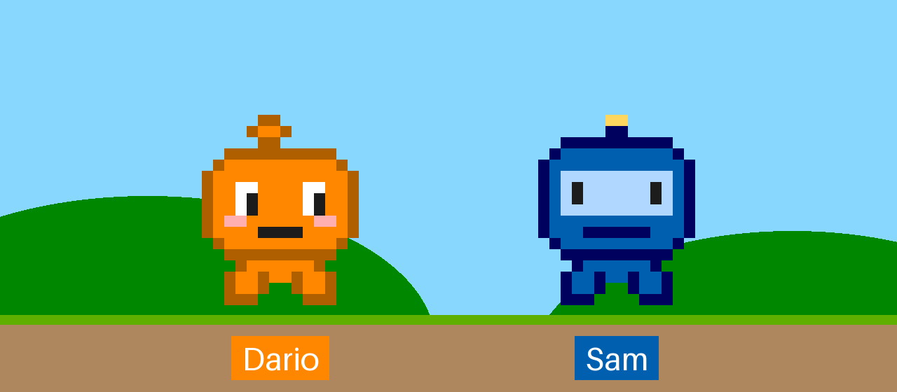
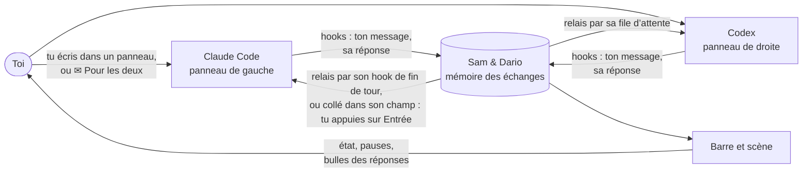
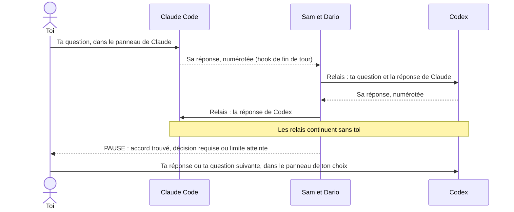

# Sam & Dario

[](https://github.com/fxbravo/sam-and-dario/actions/workflows/tests.yml)
[](LICENSE)


[English](README.md) · **Français**



**Deux assistants, deux maisons, une même ambition : aider ceux qui créent.**

Sam & Dario fait travailler ensemble Claude, d’Anthropic, et Codex, d’OpenAI. Chacun aborde un problème à sa façon. L’un voit le cas limite que l’autre a manqué, l’autre conteste l’hypothèse que le premier tenait pour acquise. Réunis, ils se complètent et se mettent à l’épreuve, et ils livrent mieux que chacun seul. Ce projet est né de cette conviction : l’alliance de ces deux modèles crée une valeur remarquable pour tous ceux qui les utilisent. Son nom est un hommage discret à celles et ceux qui les ont fait naître.

Sam & Dario est un projet indépendant, sans lien avec OpenAI ni Anthropic, et sans leur soutien. Claude Code et Codex s’installent séparément, et chacun les utilise avec ses propres comptes. Le code est publié sous [licence MIT](LICENSE).

## Ce que fait l’application

Sam & Dario ouvre Claude Code à gauche et Codex à droite dans tmux, dans le dossier de ton projet. Les deux répondent à la même question, puis Sam & Dario relaie leurs réponses. Tu peux suivre leur échange dans une scène 16 bits, avec Dario (Claude) et Sam (Codex), intervenir dans les terminaux ou prendre les relais à la main.

Pour essayer sur un projet fictif, suis le [guide du premier échange](docs/premiers-pas.md).

## Comment ça marche

Tu parles à l’un des deux assistants, ou aux deux. Sam & Dario observe chaque message et chaque réponse, puis transmet à l’autre ce qu’il a manqué. Les deux discutent ainsi jusqu’à un accord, une décision à te soumettre ou la limite de relais.



Un échange, pas à pas :



- **Tu écris où tu veux.** Écris dans un seul panneau : l’autre assistant recevra ta question avec la réponse, au relais suivant. Pour une question commune, utilise **✉ Pour les deux**.
- **Sam & Dario n’appuie jamais sur une touche à ta place.** Codex reçoit les relais par sa file d’attente. Claude les reçoit par son hook de fin de tour, qui attend jusqu’à une heure après sa réponse. Passé ce délai, ou après un passage sur `OFF`, Sam & Dario colle le relais dans le champ de Claude, et c’est toi qui appuies sur **Entrée**.
- **Chaque relais dit ce que l’autre a manqué.** Il porte un en-tête comme `[Réponse de Claude #7]`, puis tes demandes et les réponses depuis le dernier relais, et enfin la réponse la plus récente. Il tient en 100 000 caractères au plus.
- **L’échange s’arrête seul** sur un accord, sur une décision qu’ils te soumettent ou à la limite fixée par `--max`. Ta question suivante le relance.

## Installation

> **Sous Windows, utilise WSL.** Sam & Dario s’appuie sur tmux et sur des fonctions Unix que Windows n’a pas. Installe [WSL](https://learn.microsoft.com/windows/wsl/install) (le sous-système Windows pour Linux), ouvre son terminal, et suis les étapes ci-dessous à l’intérieur de WSL, comme sous Linux : tmux, Claude Code, Codex CLI, pipx et Sam & Dario s’y installent tous. Linux et WSL n’ont pas encore été testés.

1. **Installe les prérequis** : [tmux](https://github.com/tmux/tmux/wiki/Installing), [Claude Code](https://code.claude.com/docs/en/setup), [Codex CLI](https://developers.openai.com/codex/cli/) et [pipx](https://pipx.pypa.io/). Connecte les deux assistants avec tes propres comptes. Sur un Mac avec Homebrew :

   ```sh
   brew install tmux pipx
   pipx ensurepath
   ```

   Sous Ubuntu, y compris l’Ubuntu de WSL :

   ```sh
   sudo apt update
   sudo apt install -y git tmux pipx
   pipx ensurepath
   ```

   Ferme ensuite le terminal et rouvre-le, pour que le dossier de pipx soit dans ton PATH. Installe aussi Claude Code et Codex CLI à l’intérieur de WSL, en suivant leurs guides pour Linux. Ubuntu 24.04 fournit tmux 3.4, avec lequel le titre d’un accord exporté n’est pas modifiable (voir [Enregistrer un accord](#enregistrer-un-accord)). Linux et WSL n’ont pas encore été testés.

2. **Installe Sam & Dario.** pipx lui donne son propre environnement Python et place la commande `samdario` dans ton PATH. Sam & Dario ne dépend de rien d’autre que de la bibliothèque standard de Python (3.9 ou ultérieur).

   ```sh
   pipx install git+https://github.com/fxbravo/sam-and-dario.git
   samdario --version
   ```

**Pour mettre à jour** : ferme les sessions ouvertes, puis lance `pipx install --force git+https://github.com/fxbravo/sam-and-dario.git`.

**Tu avais ajouté un alias `samdario`** avec une version précédente de ce guide ? Retire sa ligne de `~/.zshrc` (ou `~/.bashrc`), puis lance `unalias samdario` dans le terminal ouvert. Sinon, `samdario` continue d’appeler l’ancien script.

Rien d’autre n’est à régler à l’avance. Sam & Dario passe ses hooks à Claude Code à chaque lancement, sans toucher à tes réglages. Au premier lancement, Codex te demande une fois de valider les deux hooks de Sam & Dario (voir plus bas). Leur commande ne dépend pas de l’endroit où Sam & Dario est installé ; Codex ne la redemande que si la commande elle-même change, par exemple après une mise à jour qui la modifie.

Pour travailler sur Sam & Dario lui-même, voir [CONTRIBUTING.md](CONTRIBUTING.md).

## Lancer Sam & Dario

Les deux assistants travaillent dans le dossier depuis lequel tu lances la commande :

```sh
cd ~/Dev/MonProjet
samdario --max 6
```

Il faut les commandes `tmux`, `claude` et `codex` dans ton PATH. Sam & Dario te demande ensuite, dans le terminal, la question commune aux deux (« Demande commune aux deux : »). Une question vide est redemandée. `--max N` fixe le nombre de relais par activation de l’auto. La valeur par défaut est 8, le minimum est 1. La question commune est exclue du compteur. L’auto démarre seul dès que les deux assistants ont répondu à cette question : voir [Mode auto](#mode-auto). `samdario --help` liste les options.

Dans un nouveau dossier, lis l’écran de confiance de Claude avant d’appuyer sur **Entrée**. Le choix **No, exit** ferme Claude. Si tu fais confiance au projet et veux l’ouvrir, sélectionne le choix correspondant.

## Une équipe par projet

Au premier lancement dans un projet, Sam & Dario demande, avant la question, un prénom pour chacun : « Prénom de Claude : », puis « Prénom de Codex : ». Laisse le premier vide pour ne pas en donner : la session fonctionne alors sans prénoms et rien n’est créé. Un prénom tient sur une ligne, en 30 caractères au plus, et les deux sont différents. Ce ne peut être ni « Claude » ni « Codex ».

Avec des prénoms, Sam & Dario crée ce qui manque à la racine du projet, sans rien écraser :

- `.samdario.json` garde les prénoms, par exemple `{"claude": "Dario", "codex": "Sam"}`. Tu peux le modifier et le versionner avec le projet.
- `AGENTS.md` porte la charte de l’équipe. Dans un projet neuf, il invite à préciser pour qui vous construisez l’application et quel résultat vous voulez obtenir, puis donne la section « Travail en binôme » et ses trois règles. Si le fichier existe déjà sans cette section, Sam & Dario te propose de l’ajouter à la fin.
- Si le projet a un `CLAUDE.md`, Claude Code ne lit pas `AGENTS.md` par défaut. Sam & Dario te propose d’ajouter la ligne `@AGENTS.md` à `CLAUDE.md`, pour que Claude lise aussi la charte.

Chaque réponse à une proposition est retenue dans `.samdario.json` et n’est plus reposée. Une proposition restée sans réponse, par exemple si tu quittes pendant la question, est reposée au lancement suivant. Les panneaux s’appellent ensuite **Dario · Claude** et **Sam · Codex**. Chaque assistant connaît son prénom et celui de son binôme dès son lancement, y compris après `/clear` chez Claude ou `/new` dans Codex. Sam & Dario leur transmet aussi, au lancement, la section « Travail en binôme » d’`AGENTS.md` : ces règles sont toujours communes. Le reste d’`AGENTS.md` est lu par chaque outil selon ses propres règles. Si un fichier du projet ou d’un dossier parent empêche l’un des deux de le lire (`CLAUDE.local.md`, `.claude/CLAUDE.md`, un `CLAUDE.md` sans import qui y mène, `AGENTS.override.md`), Sam & Dario le signale au lancement. Si Sam & Dario ne peut pas lire la consigne Codex déjà configurée, il la laisse intacte et le dit dans le panneau de Codex : pour cette session, Codex démarre alors sans son prénom ni les règles du binôme. Les en-têtes de relais gardent le nom de l’outil, par exemple `[Réponse de Claude #7]`. Les rôles (PO, développement, QA, SecOps) se donnent simplement dans la conversation.

La section « Travail en binôme » demande une revue triée. Le relecteur regarde ce qui manque ou casse, les cas limites et la preuve apportée par les tests. Il indique les tests qu’il a lui-même exécutés, puis classe chaque constat vérifié en **À corriger**, **À reporter** (seulement un problème qui existait avant le changement) ou **Décision requise**. Une décision requise t’est soumise, et Sam & Dario se met en pause jusqu’à ta réponse. Si ton `AGENTS.md` porte encore l’ancienne section par défaut, Sam & Dario te propose une fois de la remplacer par la nouvelle.

Avant d’écrire `[ACCORD]`, chacun doit donner la plus forte objection qu’il voit à la solution retenue, sur une ligne « Objection la plus forte : … », et dire pourquoi elle ne tient pas. Si elle tient, il propose un changement au lieu de conclure.

## Parler au binôme

Parle-leur comme à deux experts qui discutent entre eux : en langage normal, sans crochets ni consigne particulière. Deux façons de faire :

- **Écris dans un seul panneau**, celui de ton choix. L’assistant répond, puis Sam & Dario lui transmet la réponse de l’autre avec ta question (« Demande de l’utilisateur à … »). Ils discutent ensuite jusqu’à un accord, une décision qu’ils te soumettent ou la limite de relais. Il faut que l’auto soit actif. Après un accord ou la limite, ta nouvelle question le relance d’elle-même.
- **Pose la question pour les deux** avec le bouton **✉ Pour les deux** ou **Ctrl-b b** (section suivante). Chacun réfléchit d’abord seul, puis ils se lisent. C’est utile pour avoir deux avis indépendants avant le débat.

Ne colle pas le même texte dans les deux panneaux : Sam & Dario y verrait deux demandes séparées.

**Tu peux remplacer un relais par ta propre question.** Si Sam & Dario a collé la réponse de l’autre assistant dans un champ et que tu l’effaces pour taper autre chose, ta question part normalement : le relais effacé est « remplacé ». La réponse à ta question part en premier. Le relais effacé ne part plus seul, mais l’assistant le reçoit en contexte au premier relais suivant qui a la place. S’il est trop long pour tout relais, ce relais indique dans quel panneau le relire. Une remise incertaine garde en revanche sa pause de sécurité. Garder le relais dans ton message, avec ou sans ton commentaire, reste une remise normale.

**Lecture croisée.** À chaque question, s’ils te demandent une décision avant de s’être lus, Sam & Dario ne s’arrête pas tout de suite. Il fait d’abord lire à chacun l’avis de l’autre : deux relais, puis la réponse au second. La barre affiche alors « lecture croisée avant ta décision », et la scène l’annonce aussi. Ensuite seulement vient la pause « décision requise », avec toutes les décisions demandées sur la question, une ou plusieurs. Un accord trouvé pendant la lecture croisée n’arrête rien non plus : la décision passe d’abord. Sans décision demandée, rien ne change : un accord peut conclure dès que l’un a répondu `[ACCORD]` au relais de l’autre.

**Tu tranches dans le panneau de ton choix.** Si Sam pose la question et que tu réponds chez Dario, Sam & Dario joint à ton message, en tête, la décision de Sam que Dario n’a pas encore lue. Une décision trop longue pour être jointe (au-delà d’environ 9 000 caractères) n’est jamais coupée : la barre te dit alors chez qui répondre, par exemple « décision de Sam : réponds chez lui ». Si des réponses très longues ont été raccourcies dans les relais, la barre l’indique : « lecture croisée incomplète : la suite est dans le terminal ».

## Poser une question pour les deux

Clique sur le bouton **✉ Pour les deux** de la barre, ou appuie sur **Ctrl-b**, puis **b**. Écris ta question sur la ligne **Pour les deux** et valide avec **Entrée**. Pour un brief long, tu peux saisir « Lisez brief.md. Quel risque testeriez-vous en premier ? » Cette touche fonctionne aussi quand l’auto est actif.

Codex prend la question dans sa file. Claude la reçoit par son hook de fin de tour si celui-ci attend encore. Si la barre affiche **Entrée chez Claude**, la question est dans son brouillon. Sélectionne son panneau et appuie sur **Entrée** pour l’envoyer. Sam & Dario ne colle jamais deux messages à la suite dans le champ de Claude : si un relais y attend déjà, la barre affiche **collage en attente chez Claude** jusqu’à ce que tu l’aies envoyé. Si tu as effacé la question ou ce relais, **Ctrl-b R** dans le panneau de Claude colle ce qui est attendu : le relais d’abord, puis la question. Si l’envoi à Codex est incertain, Sam & Dario attend son accusé de réception avant de remettre la question à Claude.

Chacun répond de son côté. Les relais attendent les deux réponses à cette question numérotée. En auto, le premier relais du tour de table porte l’avis de Codex à Claude. Seuls les relais comptent pour le plafond `--max`.

Pour abandonner un tour, rouvre **Ctrl-b b** et valide une ligne vide. Si la question attend déjà dans la file de Codex, il peut encore la recevoir et y répondre après l’abandon. Les réponses tardives restent rattachées au tour abandonné, même si tu reposes aussitôt la même question. Un brouillon déjà collé reste dans le panneau. **Ctrl-C** ferme simplement l’invite et conserve le tour en cours.

## Relais manuel

1. Attends que les deux réponses soient visibles. Sélectionne le panneau **destinataire** avec la souris ou avec **Ctrl-b**, puis **o**.
2. Quand tu es dans le champ de saisie, appuie sur **Ctrl-b**, puis **r**. Le brouillon présente, dans l’ordre, les demandes et les réponses de l’autre panneau que ce destinataire doit encore lire. La dernière réponse termine le message. Si une autorisation est affichée, traite-la dans le panneau avant de coller.
3. Relis ou modifie le brouillon, puis appuie sur **Entrée**. Garde son en-tête numéroté sur sa propre ligne. Une question que tu y ajoutes accompagne la réponse au retour. Si tu effaces le brouillon, **Ctrl-b**, puis **R** le recolle. Un second **Ctrl-b r** te signale qu’il est déjà collé.
4. Depuis le terminal où tu as lancé Sam & Dario, **Ctrl-b**, puis **d** termine la session et ferme ses deux processus. Le lanceur supprime alors le dossier temporaire du relais. Depuis un second terminal attaché, ce raccourci détache uniquement ce terminal.

Tout ce que tu soumets comme demande à un seul assistant est transmis à l’autre au prochain relais, avec les réponses finales qu’il lui reste à lire. La demande commune du lancement porte le numéro 1 et chaque assistant la reçoit directement. Dans un en-tête comme `[Réponse de Claude #7]`, le numéro identifie le message. Sam & Dario réserve d’abord la place de la réponse finale dans la limite de 100 000 caractères. Si nécessaire, il omet les échanges les plus anciens et le signale. Une réponse qui dépasse à elle seule cette limite peut être relayée entière à la main.

## Mode auto

L’auto est le mode normal. Au lancement, la barre affiche `AUTO — démarre après les deux réponses`. Dès que Claude et Codex ont répondu à la question commune, l’échange commence. Au premier lancement, Codex affiche « Hooks need review » : choisis **Review hooks**, vérifie la commande de Sam & Dario pour `UserPromptSubmit` et `PermissionRequest`, approuve les deux hooks et laisse-les activés. Si tu as passé cet écran, la barre demande la validation : ouvre `/hooks` dans le panneau Codex, puis reprends avec **Ctrl-b a**. Codex mémorise la validation de cette commande. Sam & Dario en vérifie l’état à chaque activation.

Ensuite, écris simplement dans le panneau de ton choix. L’assistant à qui tu écris répond, puis sa réponse part à l’autre avec ta demande. Après `PAUSE — accord trouvé` ou `PAUSE — limite de relais atteinte`, ta demande suivante relance l’échange avec un compteur remis à zéro. La relance part à la fin de la réponse à ta demande. Un relais collé, une question « pour les deux » ou une réponse tardive à une demande plus ancienne ne relancent rien. Les autres pauses demandent toujours le geste indiqué plus bas.

Avec `AUTO 2/6`, deux relais ont été comptés sur les six autorisés. Le premier va de Codex vers Claude si aucun relais manuel n’a encore été envoyé. Codex reçoit les messages dans sa file. Claude les reçoit via son hook de fin de tour en arrière-plan. Tu gardes la main sur les demandes d’autorisation dans les deux panneaux.

Dans le panneau Claude, le message reçu est replié sous **Stop hook feedback**. Déplie-le pour lire le relais complet. La réponse de Codex reste aussi lisible dans son panneau. Pendant les essais, Codex a demandé une confirmation écrite avant d’exécuter une commande proposée par Claude. Si tu souhaites l’exécuter, confirme-la toi-même dans le panneau Codex.

Si Claude est au repos et que son hook de fin de tour n’attend plus, par exemple plus d’une heure après sa dernière réponse ou après un passage sur `OFF`, Sam & Dario colle le relais en brouillon dans son panneau. La barre affiche alors `AUTO n/max · Entrée chez Claude`. Appuie sur **Entrée** dans le panneau de Claude, et l’échange continue. Si tu as effacé ce brouillon, **Ctrl-b R** dans le panneau de Claude le recolle sans compter un relais de plus. Sam & Dario ne colle rien pendant que Claude rédige une réponse : la barre affiche `relais à Claude après son tour`, et le relais l’attend jusqu’à la fin de ce tour. Si tu as interrompu Claude avec **Échap**, son tour ne se termine pas : fais **Ctrl-b r** dans son panneau, **Entrée**, puis **Ctrl-b a**.

Pour parler à un seul assistant sans que sa réponse soit relayée, coupe l’auto avec **Ctrl-b a**, jusqu’à ce que la barre affiche `OFF`. Coupe de préférence pendant que l’auto tourne : un seul appui suffit. Depuis une pause, un premier appui relance l’auto et peut envoyer un relais avant le second. Sam & Dario demande le retrait des messages encore en file et annule l’attente de Claude. Un relais déjà collé chez Claude devient un brouillon ordinaire. Après une coupure, rien ne repart tant que tu n’appuies pas de nouveau sur **Ctrl-b a**. Si tu appuies sur **Ctrl-b a** avant les deux premières réponses, l’auto ne démarre pas.

### Changer de fil dans Codex

Après `/new`, écris ton premier message dans le nouveau fil. Avec le hook de soumission actif, Codex reçoit dès ce tour la consigne commune, la demande de lancement et les derniers échanges que Codex avait vus dans cette session Sam & Dario. Le rappel réserve jusqu’à 6 000 caractères à l’historique et signale les omissions. Si le hook est indisponible, Sam & Dario repère le fil à sa première réponse et joint le rappel au prochain relais ou à la prochaine question « aux deux » qui a assez de place.

Afficher un nouveau fil laisse l’ancien capable de traiter, hors écran, un relais qui lui était déjà destiné. Dès que Sam & Dario repère ta saisie sur le nouveau fil, les prochains envois le visent. L’accord se vérifie entre Claude et ce fil actif.

### Lire la barre et les panneaux

La barre tient sur deux lignes. La première commence par un bloc coloré : `AUTO`, `PAUSE` ou `OFF`. Viennent ensuite :

- pendant un échange, le compteur en points (`●●●○○○○○ 3/8`), le dernier relais (`Sam → Dario (#12)`) et l’assistant attendu ;
- pendant une pause, sa raison en clair ;
- à droite, en blocs ambre, ce qui t’attend : `Entrée chez Claude`, une question « pour les deux » en cours, une autorisation demandée par Codex.

La couleur du bloc d’état dit qui doit agir :

| Couleur | Signification |
|---|---|
| Vert | L’échange se déroule. |
| Vert foncé | Accord trouvé. |
| Ambre | Quelque chose t’attend : limite atteinte, Entrée, autorisation, hooks à valider. |
| Violet | Une décision t’est demandée. |
| Rouge | Un risque de doublon ou de perte : remise incertaine, suivi perdu, échec de Claude. |
| Gris | Auto coupé (`OFF`). |

Les bordures sont en trait épais. Celle du panneau actif prend la couleur de son assistant : orange pour Claude, bleu pour Codex. Le titre de chaque panneau donne le prénom et ce que fait l’assistant : « rédige sa réponse », « attend le relais », « Entrée attendue » ou « autorisation demandée ». Un `●` marque le panneau actif. Ces couleurs sont fixées par Sam & Dario et restent lisibles sur un terminal clair comme sombre. Il faut un terminal qui affiche 256 couleurs. La barre a été vérifiée sur tmux 3.6a. Si un tmux plus ancien refuse un réglage, Sam & Dario garde l’ancienne barre sur ce point.

### Les boutons de la barre

La seconde ligne de la barre est une rangée de boutons. Chacun fait la même chose que son raccourci, qui reste disponible.

| Bouton | Ce qu’il fait | Raccourci |
|---|---|---|
| **▶ Scène** / **◀ Terminaux** | Passe des terminaux à la scène, et inversement. | `Ctrl-b v` |
| **⏸ Pause** / **▶ Auto** | Met l’auto en pause, ou le relance. Le libellé suit l’état : pendant l’attente du démarrage automatique, il affiche **⏸ Pause**, qui annule ce démarrage. | `Ctrl-b a` |
| **✉ Pour les deux** | Ouvre la ligne **Pour les deux** pour poser ta question aux deux assistants. | `Ctrl-b b` |
| **⎘ Coller** | N’apparaît que si l’auto est coupé. Colle la dernière réponse de l’autre assistant dans le panneau actif : tu peux y ajouter ton mot, puis **Entrée**. | `Ctrl-b r` |
| **↻ Recoller** | N’apparaît que s’il y a vraiment quelque chose à recoller : une réponse collée en brouillon et pas encore reçue (chez Claude comme chez Codex), une remise incertaine, ou une question « pour les deux » collée ou à coller chez Claude. Il disparaît dès la réception confirmée. Recolle ce qui est attendu, par exemple un relais effacé par mégarde. | `Ctrl-b R` |
| **Exporter l’accord** | N’apparaît qu’après un accord confirmé, et le reste à la reprise de l’échange. Propose un titre modifiable, puis enregistre l’accord dans `docs/accords/` du projet. Un second clic retrouve le fichier. | `Ctrl-b e` |
| **✕ Fermer** | Seul à droite, en rouge. Demande « Fermer Sam & Dario ? (o/n) » : **o** détache ton terminal, **n** annule. Depuis le terminal de lancement, Sam & Dario se ferme alors ; depuis un second terminal attaché à la session, seul ce terminal se détache. | `Ctrl-b d` |

Coller et Recoller agissent sur le panneau actif : clique d’abord dans le panneau de Claude ou de Codex. Exporter porte sur l’accord de la session, quel que soit le panneau. Ces trois boutons n’apparaissent pas dans la scène. Un clic dans un panneau suffit à le sélectionner ; **Ctrl-b o** reste disponible.

### La scène

La scène montre l’échange en un coup d’œil, dans le style des jeux 16 bits. Dario (Claude) et Sam (Codex) y apparaissent en personnages en pixels, chacun avec sa dernière réponse dans une bulle au-dessus de la tête. Elle est dans une seconde fenêtre. Pour passer des terminaux à la scène et revenir, clique sur le bouton violet à gauche de la seconde ligne de la barre (« ▶ Scène », puis « ◀ Terminaux »), ou tape `^b v`.

- **Les bulles** prennent toute la place au-dessus des personnages. Une réponse plus longue que sa bulle défile à la molette, ou à deux doigts sur le pavé tactile : pointe la bulle de gauche pour Claude, celle de droite pour Codex. Une barre sur le bord droit montre où tu en es, « ▲ » qu’il reste du texte au-dessus, « ▼ molette pour la suite » qu’il en reste en dessous. Chaque nouvelle réponse s’affiche depuis son début. Le gras, le code en ligne et les liens Markdown s’y lisent sans leurs marques : un lien n’affiche que son texte.
- **Sous chaque personnage**, son prénom et ce qu’il fait : « rédige sa réponse », « attend le relais », « Entrée attendue »… Le `●` marque l’assistant attendu.
- **Pendant une pause**, un bandeau en haut dit pourquoi :
  - « ✦ ACCORD ✦ » en vert ;
  - « DÉCISION REQUISE » en violet, avec un `!` au-dessus de l’assistant qui demande ta décision ;
  - la raison de la pause, en ambre ou en rouge, pour les autres pauses.
- **La scène ne fait que regarder.** Pour écrire, valider une autorisation ou lire une réponse en entier, reviens aux terminaux. Fermer la scène ne ferme pas Sam & Dario.
- **Taille minimale** : 60 colonnes sur 20 lignes. En dessous, la scène demande d’agrandir la fenêtre.

Pour que le bouton réagisse au clic, Sam & Dario active la souris dans tmux. Pour sélectionner du texte avec ton terminal comme d’habitude, maintiens Option (iTerm2) ou Maj pendant que tu glisses.

### Reprendre après une pause

| Raison affichée après PAUSE | Geste à faire |
|---|---|
| Décision requise : à toi de trancher | L’un des deux, ou les deux, t’ont soumis un choix : options et recommandation, puis une ligne `[DÉCISION]`. Ils se sont lus avant (lecture croisée). Réponds en écrivant dans l’un des panneaux : celui où tu réponds reçoit la décision qu’il n’avait pas lue, et l’échange repart avec ta réponse. **Ctrl-b a** laisse le binôme poursuivre sans ta réponse. |
| Accord trouvé | Chacun a écrit `[ACCORD]` seul sur la dernière ligne de sa réponse, et la seconde répond au relais de la première. Tu peux conclure ici. Une nouvelle demande dans un panneau relance l’échange. **Ctrl-b a** poursuit la discussion sans nouvelle demande. |
| Limite de relais atteinte | Lis les derniers échanges. Une nouvelle demande dans un panneau, ou **Ctrl-b a**, ouvre une nouvelle activation avec le même plafond. |
| Hooks Codex à valider dans /hooks | Dans Codex, approuve et active les deux hooks de Sam & Dario, puis appuie sur **Ctrl-b a**. |
| Relais manuel requis vers Claude | Sam & Dario n’a pas pu coller le relais dans le panneau de Claude. Reviens au champ de saisie de Claude, puis **Ctrl-b r** et **Entrée**. Laisse Claude répondre et reprends avec **Ctrl-b a**. |
| Brouillon en attente chez Claude ou Codex | **Entrée** soumet le brouillon. Si tu l’as effacé, fais **Ctrl-b R**, **Entrée**, puis **Ctrl-b a**. La protection porte sur la même réponse. Un brouillon plus ancien laisse passer une réponse plus récente. Tu peux aussi taper ta propre question à la place du brouillon effacé : elle le remplace et relance l’échange. |
| Remise incertaine | Regarde si le destinataire a déjà reçu le message. Une confirmation tardive permet de reprendre avec **Ctrl-b a**. Pour le renvoyer à la main, fais **Ctrl-b R** dans le panneau destinataire. Lis l’avertissement éventuel sur un doublon avant **Entrée**, puis reprends avec **Ctrl-b a**. |
| Réponse au relais #n non identifiée | Dans le panneau destinataire, fais **Ctrl-b r**, vérifie la réponse choisie et envoie-la avec **Entrée**. Une fois la remise confirmée, **Ctrl-b a** reprend l’auto. |
| Réponse trop longue pour l’auto | Relaie-la à la main avec **Ctrl-b r** et **Entrée**, puis reprends avec **Ctrl-b a**. |
| Claude n’a pas pu répondre | Résous l’erreur indiquée dans Claude, soumets-lui une nouvelle demande et attends sa réponse avant **Ctrl-b a**. |
| Suivi perdu | Vérifie les deux panneaux et le message éventuel de Codex. Quand ils sont prêts, reprends avec **Ctrl-b a**. Si un panneau a fermé, relance Sam & Dario pour ouvrir une nouvelle paire. |

## Enregistrer un accord

Dans la fenêtre **Terminaux**, appuie sur **Ctrl-b**, relâche les touches, puis appuie sur **e**. Sam & Dario sélectionne le dernier accord confirmé de cette session, en manuel comme en auto. Tu peux déjà avoir repris la discussion. Si le binôme attend ta décision, l’accord confirmé précédent reste disponible. Avant le premier accord, la barre indique « Aucun accord à exporter ».

Claude Code propose un titre en un tour séparé.

- **Avec tmux 3.6 ou plus récent**, un champ de titre s’ouvre dans la barre avec la proposition de Claude. Modifie-le, puis appuie sur **Entrée** pour enregistrer. Si Claude ne propose pas de titre, saisis le tien. **Échap**, **Ctrl-C** ou un titre vide annule l’export.
- **Avec un tmux plus ancien**, comme le 3.4 d’Ubuntu 24.04, il n’y a ni champ de titre ni annulation : l’accord est enregistré dès l’export, sous le titre de Claude, ou sous « Accord » si Claude n’en propose pas. La barre affiche la version de tmux, l’origine du titre et le chemin du fichier ; renomme le fichier si tu veux.

La barre affiche le chemin du fichier, par exemple `docs/accords/demander-confirmation-avant-de-supprimer-une-liste.md`, dans le projet où tu as lancé Sam & Dario. Le document garde ta demande et les deux réponses signées, avec leurs raisons et leurs réserves. Si la demande est impossible à rattacher, le fichier l’indique.

Tu peux retoucher le document ou le renommer dans ce dossier. Garde le commentaire `<!-- samdario-accord: … -->` sous le titre. Au prochain export du même accord, **Ctrl-b e** affiche directement le chemin du fichier. Un nouvel accord qui porte le même titre reçoit un suffixe comme `-2.md`.

## Limites connues

Sam & Dario fait circuler les messages entre Claude et Codex. Il ne coordonne pas leur travail sur les fichiers, et il ne décide jamais à ta place.

**Hors de portée**

- **Deux assistants qui modifient les mêmes fichiers en même temps.** Sam & Dario ne pose aucun verrou sur le code. Si les deux codent en parallèle, l’un peut écraser le travail de l’autre. Donne-leur des rôles distincts, par exemple l’un code et l’autre relit.
- **Deux sessions Sam & Dario sur le même projet.** Chacune a sa propre mémoire et ignore l’autre. Quatre assistants peuvent alors toucher aux mêmes fichiers.
- **Git.** Sam & Dario ne gère ni branches ni commits. Si les deux committent chacun de leur côté, c’est à toi d’arbitrer.
- **Une nouvelle version de Claude Code ou de Codex.** Sam & Dario reconnaît le format de leurs hooks et le texte par lequel Claude Code remet un relais. Les essais récents ont eu lieu avec Claude Code 2.1.330, Codex 0.171.0 et tmux 3.8, sous macOS. Si une mise à jour change ces formats, la barre peut afficher « suivi perdu » ou une remise incertaine.
- **Windows.** Sam & Dario ne fonctionne pas directement sous Windows : il lui faut `tmux` et des modules Python propres à Unix. Utilise WSL (voir [Installation](#installation)). Linux et WSL n’ont pas encore été testés.

**Ce qui arrête l’échange jusqu’à ton geste**

- **Une demande d’autorisation.** L’assistant attend ta réponse dans son panneau. Sam & Dario n’approuve jamais rien à ta place. Chez Codex, ni la barre ni le titre du panneau ne signalent cette attente : lors des essais avec Codex 0.171.0, Codex n’a pas lancé le hook d’autorisation de Sam & Dario, pourtant validé. Si l’échange semble arrêté sans pause affichée, regarde le panneau de Codex.
- **Échap pendant que Claude répond.** Son tour ne se termine pas, donc Sam & Dario attend une fin qui ne viendra pas. Fais **Ctrl-b r** dans son panneau, **Entrée**, puis **Ctrl-b a**. Si c’était la réponse à une question qui remplaçait un relais, rien d’autre ne part avant sa réponse suivante.
- **Un panneau fermé ou un assistant qui plante.** La barre affiche « suivi perdu ». Relance Sam & Dario pour ouvrir une nouvelle paire.
- **Les hooks de Codex non validés.** L’auto reste en pause jusqu’à leur validation dans `/hooks`.

**Ce qui marche, avec une précaution**

- **Le même texte dans les deux panneaux** compte pour deux demandes séparées. Pour une question commune, passe par **✉ Pour les deux**.
- **Les très longues réponses.** Un relais tient en 100 000 caractères au plus. Au-delà, les échanges les plus anciens sont omis, et le message le signale. Une réponse plus longue que ce plafond se relaie à la main. Une décision de plus d’environ 9 000 caractères n’est pas jointe à ton message : la barre te dit chez qui répondre.
- **Les marqueurs de fin.** L’accord et la décision reposent sur une ligne `[ACCORD]` ou `[DÉCISION]` que les assistants placent seule à la fin de leur réponse. Tu n’as pas à les écrire. Si un assistant l’oublie, Sam & Dario ne s’arrête pas, et l’échange va jusqu’à la limite `--max`.
- **`/clear` chez Claude.** Il garde son prénom et les règles du binôme. Au relais suivant, il reçoit ce que Codex a dit depuis le début de la session, dans la limite des 100 000 caractères. Il ne retrouve ni ses propres réponses d’avant, ni les messages que tu lui avais adressés.
- **`/new` dans Codex.** Codex reçoit un rappel des derniers échanges, limité à 6 000 caractères. L’ancien fil peut encore traiter, hors écran, un relais qui lui était déjà destiné. Voir [Changer de fil dans Codex](#changer-de-fil-dans-codex).
- **Un champ de saisie occupé.** Sam & Dario ne colle jamais par-dessus ce que tu tapes chez Claude. Le relais attend que le champ soit libre.
- **L’affichage.** Pour sélectionner du texte, maintiens Option ou Maj. Dans une fenêtre trop petite, la scène masque ses bulles. Les couleurs demandent un terminal à 256 couleurs.
- **Le coût.** Chaque relais consomme des tokens chez les deux assistants. `--max`, 8 par défaut, limite le nombre de relais par activation de l’auto.

## Capture et collage

Claude Code reçoit un hook `Stop` via `--settings`. Le relais lit `last_assistant_message` dans le JSON fourni sur l’entrée standard. [Référence de Claude Code](https://code.claude.com/docs/en/hooks#stop)

Codex reçoit une commande `notify` propre à cette invocation. L’événement `agent-turn-complete` contient le champ `last-assistant-message` dans un argument JSON. [Référence de Codex](https://developers.openai.com/codex/config-advanced/#notifications)

À la première notification d’un fil, Sam & Dario vérifie son `thread-id` dans les métadonnées des sessions enregistrées sous `$CODEX_HOME/sessions` (par défaut `~/.codex/sessions`). Le fil interne qui nomme la session est ainsi écarté. Une réponse en JSON, même avec un champ `title`, se relaie normalement.

En mode manuel, le texte passe par l’entrée standard de `tmux load-buffer`, puis par `paste-buffer -p -r` dans le panneau sélectionné. Les retours à la ligne restent dans le brouillon. Le relais rend visibles les caractères de contrôle comme Échap. Le socket tmux et la base des échanges appartiennent à un répertoire temporaire privé pour chaque lancement. [Manuel de tmux](https://man.openbsd.org/tmux.1#paste-buffer)

## Vérification

Prépare un environnement de développement en suivant [CONTRIBUTING.md](CONTRIBUTING.md), puis :

```sh
.venv/bin/python -m unittest discover -s tests -t .
```

La suite rejoue, dans les deux ordres, la notification de titrage et celle du fil principal. Elle vérifie aussi le choix de la dernière réponse, les tours de table et la reprise après un échec de collage. Les tests de Claude Code utilisent un flux de réponse local. Quatre tests ouvrent un tmux privé pour vérifier les octets du collage, l’invite **Pour les deux**, les clics sur les boutons de la barre et l’export Markdown par **Ctrl-b e**. Le test d’export modifie un titre dans le terminal et relit le document après la fermeture de tmux. Les tests qui demandent tmux sont sautés s’il est absent. Les fichiers `tests/test_review_*.py` regroupent les scénarios écrits pendant les relectures du code. L’intégration continue lance tout sous Ubuntu et macOS, avec Python 3.9, 3.12 et 3.15.

L’essai manuel réalisé sous tmux 3.6a avec Claude Code 2.1.327 et Codex 0.170.0 a confirmé la notification Codex après une réponse réelle et un aller-retour complet entre les deux panneaux. Après correction du relais, un essai dans chacun des deux CLI sur pseudo-terminal a confirmé que deux collages successifs gardent une ligne vide entre eux et produisent une seule soumission après **Entrée**.

Les étapes du relais manuel permettent de vérifier les deux sens avec tes comptes. Le guide du premier échange propose aussi un essai en mode automatique.

## Licence

[MIT](LICENSE) © 2026 François-Xavier Bravo
