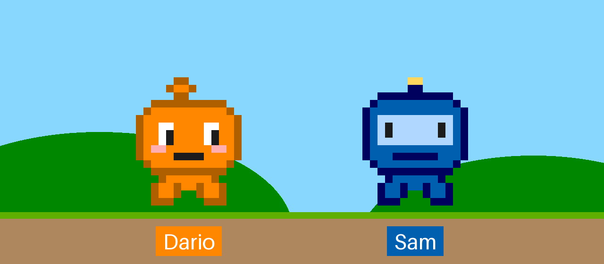
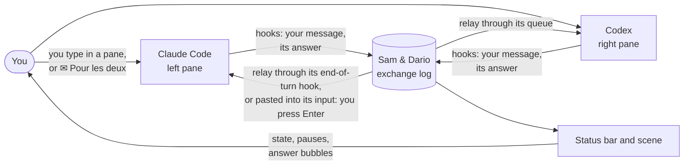
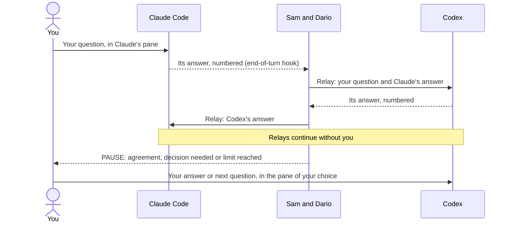

# Sam & Dario

[](https://github.com/fxbravo/sam-and-dario/actions/workflows/tests.yml)
[](LICENSE)


**English** · [Français](README.fr.md)



**Two assistants, two houses, one shared ambition: helping people build.**

Sam & Dario gets Claude, from Anthropic, and Codex, from OpenAI, working together. Each approaches a problem in its own way. One spots the edge case the other missed, the other questions the assumption the first took for granted. Together they complement and challenge each other, and deliver more than either one alone. This project grew out of that conviction: bringing these two models together creates remarkable value for everyone who uses them. Its name is a quiet tribute to the people who brought them to life.

Sam & Dario is an independent project, not affiliated with or endorsed by OpenAI or Anthropic. Claude Code and Codex are installed separately, and each person uses them with their own accounts. The code is released under the [MIT license](LICENSE).

## What it does

Sam & Dario opens Claude Code on the left and Codex on the right in tmux, in your project folder. Both answer the same question, then Sam & Dario relays each answer to the other. You can follow their exchange in a 16-bit scene, starring Dario (Claude) and Sam (Codex), step into either terminal, or relay messages by hand.

To try it on a sample project, follow the [getting started guide](docs/getting-started.md).

> **The interface is in French.** The status bar, the scene and the instructions Sam & Dario gives the assistants are in French. This guide shows each on-screen label as it appears, with its English meaning, for example **✉ Pour les deux** (for both).

## How it works

You talk to one of the two assistants, or to both. Sam & Dario records every message and every answer, then passes on to the other assistant what it missed. The two keep discussing until they agree, need a decision from you, or reach the relay limit.



One exchange, step by step:



- **Type wherever you like.** Write in one pane only: the other assistant receives your question along with the answer at the next relay. For a question to both, use **✉ Pour les deux**.
- **Sam & Dario never presses a key for you.** Codex receives relays through its queue. Claude receives them through its end-of-turn hook, which waits for up to an hour after its answer. After that, or after switching to `OFF`, Sam & Dario pastes the relay into Claude's input, and you press **Enter**.
- **Each relay says what the other missed.** It starts with a header such as `[Réponse de Claude #7]` (answer from Claude), then your requests and the answers since the last relay, and ends with the latest answer. A relay holds at most 100,000 characters.
- **The exchange stops by itself** on an agreement, on a decision they put to you, or at the limit set with `--max`. Your next question restarts it.

## Installation

> **On Windows, use WSL.** Sam & Dario relies on tmux and on Unix features that Windows lacks. Install nothing on Windows itself, not even Python or pipx. Open PowerShell as administrator and run `wsl --install`: it installs [WSL](https://learn.microsoft.com/windows/wsl/install) (Windows Subsystem for Linux) with Ubuntu. Restart if Windows asks you to, then open **Ubuntu** from the Start menu. Follow the steps below in that Ubuntu terminal, as on Linux: tmux, Claude Code, Codex CLI, pipx and Sam & Dario all go there.

1. **Install the prerequisites**: [tmux](https://github.com/tmux/tmux/wiki/Installing), [Claude Code](https://code.claude.com/docs/en/setup), [Codex CLI](https://developers.openai.com/codex/cli/) and [pipx](https://pipx.pypa.io/). Sign in to both assistants with your own accounts. On a Mac with Homebrew:

   ```sh
   brew install tmux pipx
   pipx ensurepath
   ```

   On Ubuntu, including Ubuntu in WSL:

   ```sh
   sudo apt update
   sudo apt install -y git tmux pipx
   pipx ensurepath
   ```

   Then close and reopen the terminal, so that pipx's folder is in your PATH. Install Claude Code and Codex CLI inside WSL too, following their guides for Linux. Ubuntu 24.04 ships tmux 3.4, with which the title of an exported agreement cannot be edited (see [Saving an agreement](#saving-an-agreement)).

2. **Install Sam & Dario.** pipx gives it its own Python environment and puts the `samdario` command in your PATH. Sam & Dario has no dependencies beyond the Python standard library (3.9 or later).

   ```sh
   pipx install git+https://github.com/fxbravo/sam-and-dario.git
   samdario --version
   ```

**Without pipx** (if your Linux distribution has no `pipx` package, for example), a Python virtual environment does the same job. On Ubuntu and Debian, first run `sudo apt install -y git python3-venv`. Then:

```sh
python3 -m venv ~/.local/share/samdario
~/.local/share/samdario/bin/pip install git+https://github.com/fxbravo/sam-and-dario.git
mkdir -p ~/.local/bin
ln -sf ~/.local/share/samdario/bin/samdario ~/.local/bin/samdario
samdario --version
```

If the terminal answers that `samdario` is not found, close and reopen it: Ubuntu adds `~/.local/bin` to the PATH when that folder exists. On other systems, add it to the PATH in `~/.bashrc`.

**Updating**: close open sessions, then run `pipx install --force git+https://github.com/fxbravo/sam-and-dario.git`. Without pipx: `~/.local/share/samdario/bin/pip install --force-reinstall git+https://github.com/fxbravo/sam-and-dario.git`.

**Had you added a `samdario` alias** with an earlier version of this guide? Remove its line from `~/.zshrc` (or `~/.bashrc`), then run `unalias samdario` in the open terminal. Otherwise `samdario` keeps calling the old script.

Nothing else needs setting up beforehand. Sam & Dario passes its hooks to Claude Code at each launch, without touching your settings. On the first launch, Codex asks you once to approve Sam & Dario's two hooks (see below). Their command does not depend on where Sam & Dario is installed; Codex only asks again if the command itself changes, for example after an update that changes it.

To work on Sam & Dario itself, see [CONTRIBUTING.md](CONTRIBUTING.md).

## Launching Sam & Dario

Both assistants work in the folder you launch the command from:

```sh
cd ~/Dev/MyProject
samdario --max 6
```

You need the `tmux`, `claude` and `codex` commands in your PATH. Sam & Dario then asks, in the terminal, for the question shared by both (« Demande commune aux deux : », shared request). An empty question is asked again. `--max N` sets the number of relays per auto activation. The default is 8 and the minimum is 1. The shared question does not count. The auto mode starts by itself as soon as both assistants have answered that question: see [Auto mode](#auto-mode). `samdario --help` lists the options.

In a new folder, read Claude's trust screen before pressing **Enter**. Choosing **No, exit** closes Claude. If you trust the project and want to open it, select the matching option.

## One team per project

The first time you launch Sam & Dario in a project, it asks for a first name for each assistant, before the question: « Prénom de Claude : », then « Prénom de Codex : ». Leave the first one empty to skip names: the session then runs without names and nothing is created. A name fits on one line, has at most 30 characters, and the two must differ. It cannot be "Claude" or "Codex".

With names, Sam & Dario creates what is missing at the project root, without overwriting anything:

- `.samdario.json` stores the names, for example `{"claude": "Dario", "codex": "Sam"}`. You can edit it and commit it with the project.
- `AGENTS.md` holds the team charter. In a new project, it asks who you are building the application for and what result you want, then gives the « Travail en binôme » (working as a pair) section and its three rules. If the file already exists without that section, Sam & Dario offers to append it.
- If the project has a `CLAUDE.md`, Claude Code does not read `AGENTS.md` by default. Sam & Dario offers to add the line `@AGENTS.md` to `CLAUDE.md`, so that Claude reads the charter too.

Each answer to a proposal is stored in `.samdario.json` and never asked again. A proposal left unanswered, for example if you quit during the question, is asked again at the next launch. The panes are then called **Dario · Claude** and **Sam · Codex**. Each assistant knows its own name and its partner's from launch, including after `/clear` in Claude or `/new` in Codex. Sam & Dario also sends them, at launch, the « Travail en binôme » section of `AGENTS.md`: those rules are always shared. The rest of `AGENTS.md` is read by each tool according to its own rules. If a file in the project or in a parent folder prevents one of them from reading it (`CLAUDE.local.md`, `.claude/CLAUDE.md`, a `CLAUDE.md` with no import leading to it, `AGENTS.override.md`), Sam & Dario reports it at launch. If Sam & Dario cannot read the Codex instructions already configured, it leaves them untouched and says so in the Codex pane: for that session, Codex starts without its name or the pair's rules. Relay headers keep the tool name, for example `[Réponse de Claude #7]`. Roles (product owner, development, QA, SecOps) are simply given in the conversation.

The « Travail en binôme » section asks for a sorted review. The reviewer looks at what is missing or broken, edge cases and the evidence the tests provide. They state which tests they ran themselves, then file each verified finding as **À corriger** (to fix), **À reporter** (to defer, only for a problem that existed before the change) or **Décision requise** (decision needed). A decision needed is put to you, and Sam & Dario pauses until you answer. If your `AGENTS.md` still has the previous default section, Sam & Dario offers once to replace it with the new one.

Before writing `[ACCORD]` (agreement), each assistant must state the strongest objection it sees to the chosen solution, on a line « Objection la plus forte : … » (strongest objection), and say why it does not hold. If it does hold, the assistant proposes a change instead of concluding.

## Talking to the pair

Talk to them as you would to two experts discussing among themselves: in plain language, with no brackets or special instructions. There are two ways:

- **Write in a single pane**, whichever you like. That assistant answers, then Sam & Dario sends its answer to the other one together with your question (« Demande de l’utilisateur à … », request from the user to …). They then discuss until they agree, put a decision to you, or reach the relay limit. The auto mode must be on. After an agreement or the limit, your new question restarts it by itself.
- **Ask both** with the **✉ Pour les deux** button or **Ctrl-b b** (next section). Each first thinks on its own, then they read each other. This is useful to get two independent opinions before the debate.

Do not paste the same text into both panes: Sam & Dario would see two separate requests.

**You can replace a relay with your own question.** If Sam & Dario pasted the other assistant's answer into an input and you delete it to type something else, your question goes through normally: the deleted relay is "replaced". The answer to your question goes first. The deleted relay is no longer sent on its own, but the assistant receives it as context in the next relay that has room for it. If it is too long for any relay, that relay says which pane to read it in. An uncertain delivery, however, keeps its safety pause. Keeping the relay in your message, with or without your comment, is still a normal delivery.

**Cross-reading.** On each question, if they ask you for a decision before reading each other, Sam & Dario does not stop right away. It first has each one read the other's view: two relays, then the answer to the second. The status bar then shows « lecture croisée avant ta décision » (cross-reading before your decision), and the scene announces it too. Only then comes the « décision requise » (decision needed) pause, with every decision requested on that question, one or more. An agreement reached during cross-reading does not stop anything either: the decision comes first. When no decision is requested, nothing changes: an agreement can conclude as soon as one of them answers `[ACCORD]` to the other's relay.

**You decide in the pane of your choice.** If Sam asks the question and you answer in Dario's pane, Sam & Dario adds Sam's decision, which Dario has not read yet, at the top of your message. A decision too long to be attached (beyond about 9,000 characters) is never cut: the status bar tells you where to answer instead, for example « décision de Sam : réponds chez lui » (Sam's decision: answer in his pane). If very long answers were shortened in the relays, the status bar says so: « lecture croisée incomplète : la suite est dans le terminal » (incomplete cross-reading: the rest is in the terminal).

## Asking both

Click the **✉ Pour les deux** (for both) button in the status bar, or press **Ctrl-b**, then **b**. Type your question on the **Pour les deux** line and confirm with **Enter**. For a long brief, you can type « Read brief.md. Which risk would you test first? » This works while the auto mode is on as well.

Codex picks up the question from its queue. Claude receives it through its end-of-turn hook if the hook is still waiting. If the status bar shows **Entrée chez Claude** (Enter in Claude's pane), the question is in Claude's input. Select its pane and press **Enter** to send it. Sam & Dario never pastes two messages in a row into Claude's input: if a relay is already waiting there, the status bar shows **collage en attente chez Claude** (paste waiting in Claude's pane) until you have sent it. If you deleted the question or that relay, **Ctrl-b R** in Claude's pane pastes what is expected: the relay first, then the question. If the delivery to Codex is uncertain, Sam & Dario waits for its acknowledgement before handing the question to Claude.

Each answers on its own side. Relays wait for both answers to that numbered question. In auto mode, the first relay of the round carries Codex's view to Claude. Only relays count towards the `--max` limit.

To abandon a round, reopen **Ctrl-b b** and confirm an empty line. If the question is already waiting in Codex's queue, Codex may still receive it and answer after you abandon. Late answers stay attached to the abandoned round, even if you ask the same question again right away. A draft already pasted stays in its pane. **Ctrl-C** simply closes the prompt and keeps the current round.

## Manual relay

1. Wait until both answers are visible. Select the **receiving** pane with the mouse, or with **Ctrl-b**, then **o**.
2. In the input field, press **Ctrl-b**, then **r**. The draft lists, in order, the requests and answers from the other pane that this assistant has not read yet. The latest answer ends the message. If a permission prompt is showing, handle it in the pane before pasting.
3. Read or edit the draft, then press **Enter**. Keep its numbered header on its own line. A question you add travels with the answer. If you delete the draft, **Ctrl-b**, then **R** pastes it again. A second **Ctrl-b r** tells you it is already pasted.
4. From the terminal where you launched Sam & Dario, **Ctrl-b**, then **d** ends the session and closes both processes. The launcher then deletes the relay's temporary folder. From a second attached terminal, this shortcut only detaches that terminal.

Anything you submit as a request to one assistant is passed on to the other at the next relay, along with the final answers it still has to read. The shared launch request has number 1, and each assistant receives it directly. In a header such as `[Réponse de Claude #7]`, the number identifies the message. Sam & Dario first reserves room for the final answer within the 100,000-character limit. If needed, it leaves out the oldest exchanges and says so. An answer that exceeds that limit on its own can be relayed in full by hand.

## Auto mode

Auto is the normal mode. At launch, the status bar shows `AUTO — démarre après les deux réponses` (starts after both answers). As soon as Claude and Codex have answered the shared question, the exchange begins. On the first launch, Codex shows "Hooks need review": choose **Review hooks**, check Sam & Dario's command for `UserPromptSubmit` and `PermissionRequest`, approve both hooks and leave them enabled. If you skipped that screen, the status bar asks for the approval: open `/hooks` in the Codex pane, then resume with **Ctrl-b a**. Codex remembers the approval of this command. Sam & Dario checks its status on each activation.

After that, simply write in the pane of your choice. The assistant you write to answers, then its answer goes to the other one with your request. After `PAUSE — accord trouvé` (agreement found) or `PAUSE — limite de relais atteinte` (relay limit reached), your next request restarts the exchange with the counter reset. The restart happens when the answer to your request arrives. A pasted relay, a question to both or a late answer to an older request restarts nothing. The other pauses always need the action shown further down.

With `AUTO 2/6`, two relays have been counted out of the six allowed. The first one goes from Codex to Claude if no manual relay has been sent yet. Codex receives messages in its queue. Claude receives them through its end-of-turn hook, running in the background. You keep control of permission prompts in both panes.

In Claude's pane, the received message is folded under **Stop hook feedback**. Unfold it to read the full relay. Codex's answer also remains readable in its own pane. During testing, Codex asked for written confirmation before running a command suggested by Claude. If you want it to run, confirm it yourself in the Codex pane.

If Claude is idle and its end-of-turn hook is no longer waiting, for example more than an hour after its last answer or after switching to `OFF`, Sam & Dario pastes the relay as a draft into its pane. The status bar then shows `AUTO n/max · Entrée chez Claude`. Press **Enter** in Claude's pane, and the exchange continues. If you deleted that draft, **Ctrl-b R** in Claude's pane pastes it again without counting an extra relay. Sam & Dario pastes nothing while Claude is writing an answer: the status bar shows `relais à Claude après son tour` (relay to Claude after its turn), and the relay waits until that turn ends. If you interrupted Claude with **Esc**, its turn never ends: press **Ctrl-b r** in its pane, **Enter**, then **Ctrl-b a**.

To talk to a single assistant without its answer being relayed, turn the auto mode off with **Ctrl-b a** until the status bar shows `OFF`. Preferably do it while the auto mode is running: one press is enough. From a pause, a first press restarts the auto mode and may send a relay before the second press. Sam & Dario asks Codex to withdraw messages still in its queue and cancels Claude's wait. A relay already pasted in Claude's pane becomes an ordinary draft. Once switched off, nothing restarts until you press **Ctrl-b a** again. If you press **Ctrl-b a** before the first two answers, the auto mode does not start.

### Switching threads in Codex

After `/new`, write your first message in the new thread. With the submit hook active, Codex receives, in that same turn, the shared instructions, the launch request and the latest exchanges Codex had seen in this Sam & Dario session. The reminder keeps up to 6,000 characters for the history and says when something was left out. If the hook is unavailable, Sam & Dario spots the thread at its first answer and attaches the reminder to the next relay, or to the next question to both, that has enough room.

Showing a new thread leaves the old one able to process, off screen, a relay that was already addressed to it. As soon as Sam & Dario sees you typing in the new thread, the next deliveries target it. Agreement is checked between Claude and that active thread.

### Reading the status bar and panes

The status bar has two lines. The first starts with a colored block: `AUTO`, `PAUSE` or `OFF`. Then come:

- during an exchange, the counter in dots (`●●●○○○○○ 3/8`), the last relay (`Sam → Dario (#12)`) and the assistant being waited on;
- during a pause, its reason in plain words;
- on the right, in amber blocks, what is waiting for you: `Entrée chez Claude`, a question to both in progress, a permission requested by Codex.

The color of the state block tells you who needs to act:

| Color | Meaning |
|---|---|
| Green | The exchange is running. |
| Dark green | Agreement found. |
| Amber | Something is waiting for you: limit reached, Enter, permission, hooks to approve. |
| Purple | A decision is needed from you. |
| Red | A risk of duplicate or loss: uncertain delivery, tracking lost, Claude failure. |
| Grey | Auto off (`OFF`). |

Borders are drawn in heavy lines. The active pane's border takes its assistant's color: orange for Claude, blue for Codex. Each pane title gives the name and what the assistant is doing: « rédige sa réponse » (writing its answer), « attend le relais » (waiting for the relay), « Entrée attendue » (Enter expected) or « autorisation demandée » (permission requested). A `●` marks the active pane. These colors are set by Sam & Dario and stay readable on light and dark terminals alike. You need a terminal with 256 colors. The status bar was checked on tmux 3.6a. If an older tmux rejects a setting, Sam & Dario keeps the previous bar for that setting.

### Status bar buttons

The second line of the status bar is a row of buttons. Each does the same as its shortcut, which remains available.

| Button | What it does | Shortcut |
|---|---|---|
| **▶ Scène** / **◀ Terminaux** | Switches from the terminals to the scene, and back. | `Ctrl-b v` |
| **⏸ Pause** / **▶ Auto** | Pauses the auto mode, or restarts it. The label follows the state: while waiting for the automatic start, it shows **⏸ Pause**, which cancels that start. | `Ctrl-b a` |
| **✉ Pour les deux** | Opens the **Pour les deux** (for both) line to ask both assistants your question. | `Ctrl-b b` |
| **⎘ Coller** (paste) | Only shown when the auto mode is off. Pastes the other assistant's latest answer into the active pane: you can add your own words, then **Enter**. | `Ctrl-b r` |
| **↻ Recoller** (paste again) | Only shown when there really is something to paste again: an answer pasted as a draft and not yet received (in Claude's or Codex's pane), an uncertain delivery, or a question to both pasted or waiting to be pasted in Claude's pane. It disappears once receipt is confirmed. It pastes what is expected, for example a relay deleted by mistake. | `Ctrl-b R` |
| **Exporter l’accord** (export the agreement) | Only shown after a confirmed agreement, and stays when the exchange resumes. Suggests an editable title, then saves the agreement in the project's `docs/accords/` folder. A second click finds the file again. | `Ctrl-b e` |
| **✕ Fermer** (close) | Alone on the right, in red. Asks « Fermer Sam & Dario ? (o/n) » (close Sam & Dario? yes/no): **o** detaches your terminal, **n** cancels. From the launch terminal, Sam & Dario then closes; from a second terminal attached to the session, only that terminal detaches. | `Ctrl-b d` |

Coller and Recoller act on the active pane: click in Claude's or Codex's pane first. Export applies to the session's agreement, whatever the pane. These three buttons do not appear in the scene. One click in a pane selects it; **Ctrl-b o** is still available.

### The scene

The scene shows the exchange at a glance, in the style of 16-bit video games. Dario (Claude) and Sam (Codex) appear as pixel characters, each with its latest answer in a speech bubble above its head. It lives in a second window. To switch from the terminals to the scene and back, click the purple button on the left of the second status line (« ▶ Scène », then « ◀ Terminaux »), or type `^b v`.

- **The bubbles** take all the space above the characters. An answer longer than its bubble scrolls with the mouse wheel, or with two fingers on a trackpad: point at the left bubble for Claude, the right one for Codex. A bar on the right edge shows where you are; « ▲ » means there is text above, « ▼ molette pour la suite » (wheel for more) means there is text below. Each new answer is shown from its start. Bold, inline code and Markdown links are shown without their markup: a link shows only its text.
- **Under each character**, its name and what it is doing: « rédige sa réponse », « attend le relais », « Entrée attendue »… The `●` marks the assistant being waited on.
- **During a pause**, a banner at the top says why:
  - « ✦ ACCORD ✦ » (agreement) in green;
  - « DÉCISION REQUISE » (decision needed) in purple, with a `!` above the assistant asking for your decision;
  - the reason for the pause, in amber or red, for other pauses.
- **The scene only watches.** To type, approve a permission or read an answer in full, go back to the terminals. Closing the scene does not close Sam & Dario.
- **Minimum size**: 60 columns by 20 lines. Below that, the scene asks you to enlarge the window.

For the buttons to respond to clicks, Sam & Dario turns on the mouse in tmux. To select text with your terminal as usual, hold Option (iTerm2) or Shift while you drag.

### Resuming after a pause

| Reason shown after PAUSE | What to do |
|---|---|
| « Décision requise : à toi de trancher » (decision needed: your call) | One or both of them put a choice to you: options and a recommendation, then a `[DÉCISION]` line. They read each other first (cross-reading). Answer by writing in either pane: the pane you answer in receives the decision it had not read, and the exchange resumes with your answer. **Ctrl-b a** lets the pair go on without your answer. |
| « Accord trouvé » (agreement found) | Each wrote `[ACCORD]` alone on the last line of its answer, and the second one answers the first one's relay. You can stop here. A new request in a pane restarts the exchange. **Ctrl-b a** continues the discussion without a new request. |
| « Limite de relais atteinte » (relay limit reached) | Read the latest exchanges. A new request in a pane, or **Ctrl-b a**, opens a new activation with the same limit. |
| « Hooks Codex à valider dans /hooks » (Codex hooks to approve) | In Codex, approve and enable Sam & Dario's two hooks, then press **Ctrl-b a**. |
| « Relais manuel requis vers Claude » (manual relay needed to Claude) | Sam & Dario could not paste the relay into Claude's pane. Go back to Claude's input, then **Ctrl-b r** and **Enter**. Let Claude answer and resume with **Ctrl-b a**. |
| « Brouillon en attente » (draft waiting) in Claude's or Codex's pane | **Enter** submits the draft. If you deleted it, press **Ctrl-b R**, **Enter**, then **Ctrl-b a**. The protection applies to that same answer. An older draft lets a newer answer through. You can also type your own question instead of the deleted draft: it replaces it and restarts the exchange. |
| « Remise incertaine » (uncertain delivery) | Check whether the recipient already received the message. A late confirmation lets you resume with **Ctrl-b a**. To resend it by hand, press **Ctrl-b R** in the receiving pane. Read any duplicate warning before **Enter**, then resume with **Ctrl-b a**. |
| Answer to relay #n not identified | In the receiving pane, press **Ctrl-b r**, check the chosen answer and send it with **Enter**. Once the delivery is confirmed, **Ctrl-b a** resumes the auto mode. |
| Answer too long for the auto mode | Relay it by hand with **Ctrl-b r** and **Enter**, then resume with **Ctrl-b a**. |
| Claude could not answer | Fix the error shown in Claude, send it a new request and wait for its answer before **Ctrl-b a**. |
| « Suivi perdu » (tracking lost) | Check both panes and any message from Codex. When they are ready, resume with **Ctrl-b a**. If a pane has closed, relaunch Sam & Dario to open a new pair. |

## Saving an agreement

In the **Terminaux** window, press **Ctrl-b**, release the keys, then press **e**. Sam & Dario picks the session's latest confirmed agreement, in manual or auto mode. You may already have resumed the discussion. If the pair is waiting for your decision, the previous confirmed agreement is still available. Before the first agreement, the status bar shows « Aucun accord à exporter » (no agreement to export).

Claude Code suggests a title in a separate turn.

- **With tmux 3.6 or later**, a title field opens in the status bar with Claude's suggestion. Edit it, then press **Enter** to save. If Claude suggests no title, type your own. **Esc**, **Ctrl-C** or an empty title cancels the export.
- **With an older tmux**, such as Ubuntu 24.04's 3.4, there is no title field and nothing to cancel: the agreement is saved as soon as you export it, under Claude's title, or under « Accord » if Claude suggests none. The status bar shows the tmux version, where the title came from and the file path; rename the file if you like.

The status bar shows the file path, for example `docs/accords/demander-confirmation-avant-de-supprimer-une-liste.md`, in the project where you launched Sam & Dario. The document keeps your request and both signed answers, with their reasons and reservations. If the request cannot be traced, the file says so.

You can edit the document or rename it within that folder. Keep the `<!-- samdario-accord: … -->` comment under the title. The next time you export the same agreement, **Ctrl-b e** shows the file path directly. A new agreement with the same title gets a suffix such as `-2.md`.

## Known limitations

Sam & Dario moves messages between Claude and Codex. It does not coordinate their work on files, and it never decides for you.

**Out of scope**

- **Both assistants editing the same files at the same time.** Sam & Dario puts no lock on the code. If both write code in parallel, one may overwrite the other's work. Give them distinct roles, for example one writes the code and the other reviews it.
- **Two Sam & Dario sessions on the same project.** Each has its own log and ignores the other. Four assistants may then touch the same files.
- **Git.** Sam & Dario manages neither branches nor commits. If both commit on their own, it is up to you to sort it out.
- **A new version of Claude Code or Codex.** Sam & Dario recognizes the format of their hooks and the text with which Claude Code delivers a relay. Recent tests used Claude Code 2.1.330, Codex 0.171.0 and tmux 3.8, on macOS. Sam & Dario has also been tried on Linux and in WSL. If an update changes these formats, the status bar may show « suivi perdu » (tracking lost) or an uncertain delivery.
- **Windows.** Sam & Dario does not run on Windows itself: it needs `tmux` and Unix-only Python modules. Use WSL instead (see [Installation](#installation)).

**What stops the exchange until you act**

- **A permission prompt.** The assistant waits for your answer in its pane. Sam & Dario never approves anything for you. In Codex's case, neither the status bar nor the pane title shows this wait: in tests with Codex 0.171.0, Codex did not run Sam & Dario's permission hook, even though it was approved. If the exchange seems stuck with no pause shown, look at the Codex pane.
- **Esc while Claude is answering.** Its turn never ends, so Sam & Dario waits for an end that will not come. Press **Ctrl-b r** in its pane, **Enter**, then **Ctrl-b a**. If that was the answer to a question that replaced a relay, nothing else goes out before its next answer.
- **A closed pane or a crashed assistant.** The status bar shows « suivi perdu » (tracking lost). Relaunch Sam & Dario to open a new pair.
- **Codex hooks not approved.** The auto mode stays paused until you approve them in `/hooks`.

**What works, with a precaution**

- **The same text in both panes** counts as two separate requests. For a shared question, use **✉ Pour les deux**.
- **Very long answers.** A relay holds at most 100,000 characters. Beyond that, the oldest exchanges are left out, and the message says so. An answer longer than that limit is relayed by hand. A decision longer than about 9,000 characters is not attached to your message: the status bar tells you where to answer.
- **End markers.** Agreements and decisions rely on an `[ACCORD]` or `[DÉCISION]` line that the assistants put alone at the end of their answer. You do not have to write them. If an assistant forgets, Sam & Dario does not stop, and the exchange runs until the `--max` limit.
- **`/clear` in Claude.** Claude keeps its name and the pair's rules. At the next relay, it receives what Codex has said since the start of the session, within 100,000 characters. It recovers neither its own earlier answers nor the messages you had sent it.
- **`/new` in Codex.** Codex receives a reminder of the latest exchanges, limited to 6,000 characters. The old thread may still process, off screen, a relay already addressed to it. See [Switching threads in Codex](#switching-threads-in-codex).
- **A busy input field.** Sam & Dario never pastes over what you are typing in Claude's pane. The relay waits until the field is free.
- **Display.** To select text, hold Option or Shift. In a window that is too small, the scene hides its bubbles. The colors need a 256-color terminal.
- **Cost.** Each relay uses tokens on both assistants. `--max`, 8 by default, limits the number of relays per auto activation.

## Capture and paste

Claude Code receives a `Stop` hook through `--settings`. The relay reads `last_assistant_message` from the JSON provided on standard input. [Claude Code reference](https://code.claude.com/docs/en/hooks#stop)

Codex receives a `notify` command specific to this invocation. The `agent-turn-complete` event carries the `last-assistant-message` field in a JSON argument. [Codex reference](https://developers.openai.com/codex/config-advanced/#notifications)

On a thread's first notification, Sam & Dario checks its `thread-id` in the metadata of the sessions stored under `$CODEX_HOME/sessions` (by default `~/.codex/sessions`). This rules out the internal thread that names the session. An answer in JSON, even with a `title` field, is relayed normally.

In manual mode, the text goes through the standard input of `tmux load-buffer`, then through `paste-buffer -p -r` into the selected pane. Line breaks stay in the draft. The relay makes control characters such as Esc visible. The tmux socket and the exchange database live in a private temporary folder for each launch. [tmux manual](https://man.openbsd.org/tmux.1#paste-buffer)

## Testing

See [CONTRIBUTING.md](CONTRIBUTING.md) to set up a development environment, then:

```sh
.venv/bin/python -m unittest discover -s tests -t .
```

The suite replays, in both orders, the title notification and the main thread's notification. It also checks the choice of the latest answer, rounds with both assistants and recovery after a failed paste. The Claude Code tests use a local response stream. Four tests open a private tmux to check the pasted bytes, the **Pour les deux** prompt, clicks on the status bar buttons and the Markdown export with **Ctrl-b e**. The export test edits a title in the terminal and reads the document back after tmux closes. The tests that need tmux are skipped if it is missing. The `tests/test_review_*.py` files hold the scenarios written during the code reviews. Continuous integration runs everything on Ubuntu and macOS, with Python 3.9, 3.12 and 3.15.

The manual tests under tmux 3.6a with Claude Code 2.1.327 and Codex 0.170.0 confirmed the Codex notification after a real answer and a full round trip between the two panes. After a relay fix, a test in each of the two CLIs on a pseudo-terminal confirmed that two successive pastes keep a blank line between them and produce a single submission after **Enter**.

The manual relay steps let you check both directions with your own accounts. The getting started guide also offers a test in auto mode.

## License

[MIT](LICENSE) © 2026 François-Xavier Bravo
